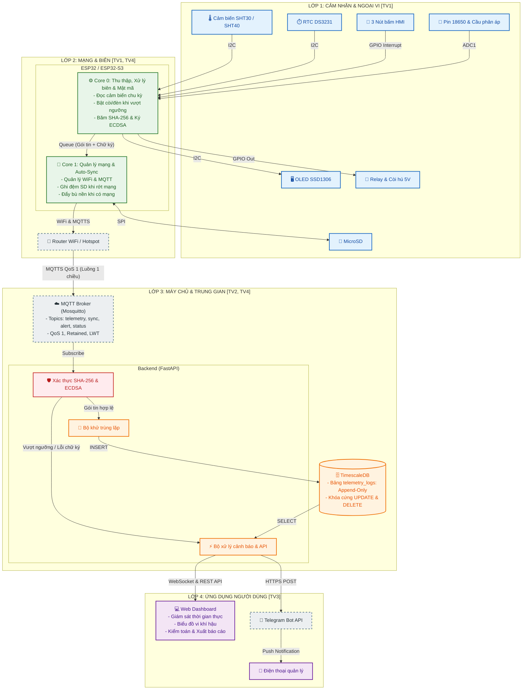

# Kiến trúc hệ thống và giao thức truyền thông

Phụ trách: TV4

---

## 1. Sơ đồ kiến trúc 4 lớp

---

## 2. Lựa chọn công nghệ và giao thức

| Thành phần | Lựa chọn | Phương án loại bỏ | Lý do kỹ thuật |
| :--- | :--- | :--- | :--- |
| **Thiết bị → Broker** | **MQTT** | HTTP REST, CoAP | Nhẹ, tối ưu cho mạng chập chờn; hỗ trợ QoS 1 đảm bảo đẩy bù không mất gói và LWT để phát hiện mất kết nối ngay lập tức. |
| **Luồng dữ liệu** | **Một chiều** | Điều khiển 2 chiều từ xa | Đảm bảo tính pháp lý GSP: thiết bị chỉ đọc và gửi, tuyệt đối không nhận lệnh điều khiển từ xa để tránh can thiệp ngoài ý muốn. |
| **Cơ sở dữ liệu** | **TimescaleDB** | MongoDB, MySQL | Tối ưu chuỗi thời gian qua Hypertable; hỗ trợ `ON CONFLICT (device_id, ts_rtc) DO NOTHING` khử trùng lặp và Trigger khóa cứng `UPDATE/DELETE`. |
| **Server → Web** | **REST API + WebSocket** | HTTP Polling | WebSocket đẩy dữ liệu và cảnh báo theo thời gian thực tới trình duyệt mà không cần client gửi request liên tục. |
