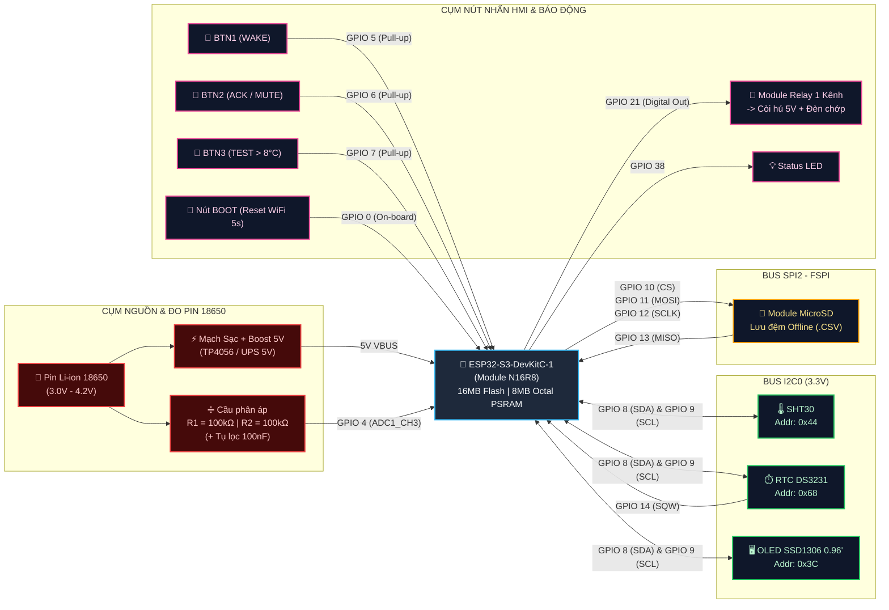

# Sơ đồ Đấu nối Phần cứng

## 1. Bảng Tổng hợp Gán chân

| Cụm chức năng | Linh kiện ngoại vi | Chân Linh kiện | Chân ESP32-S3 | Giao thức / Cấu hình | Điện áp cấp (VCC) |
| :--- | :--- | :--- | :--- | :--- | :--- |
| **Bus I2C0**<br>*(Dùng chung)* | Cảm biến **SHT30** (`0x44`)<br>RTC **DS3231** (`0x68`)<br>Màn **OLED SSD1306** (`0x3C`) | `SDA`<br>`SCL` | **GPIO 8**<br>**GPIO 9** | `I2C0` (400kHz) | `3.3V` |
| **Đồng bộ thời gian** | IC Thời gian thực **DS3231** | `SQW` / `INT` | **GPIO 14** | `INPUT_PULLUP` (Ngắt 1Hz) | *(Chung nguồn I2C)* |
| **Lưu trữ Offline** | Module thẻ nhớ **MicroSD** | `CS`<br>`MOSI`<br>`CLK` (`SCK`)<br>`MISO` | **GPIO 10**<br>**GPIO 11**<br>**GPIO 12**<br>**GPIO 13** | `SPI2` (FSPI phần cứng) | `5V` *(Module 6 chân có IC)*<br>hoặc `3.3V` *(Loại trực tiếp)* |
| **Đo điện áp Pin** | Cầu phân áp **2x 100kΩ** | Điểm giữa 2 trở | **GPIO 4** | `ADC1_CH3` (12-bit, 11dB) | `3.0V – 4.2V` (Chia đôi về `1.5V – 2.1V`) |
| **Báo động tại chỗ** | Module **Relay 1 Kênh** + Còi/Đèn | `IN` (Tín hiệu) | **GPIO 21** | `OUTPUT` (Tích cực CAO) | `5V` (Chân `VCC` của Relay) |
| **Giao diện HMI** | **BTN1** (Bật OLED / Chuyển trang)<br>**BTN2** (ACK / Tắt còi tại chỗ)<br>**BTN3** (Test vượt ngưỡng GSP) | Chân 1 nút nhấn<br>*(Chân 2 nối GND)* | **GPIO 5**<br>**GPIO 6**<br>**GPIO 7** | `INPUT_PULLUP`<br>(Nhấn = Mức `LOW`) | Không cần cấp `VCC` |
| **Cấu hình mạng** | Nút **BOOT** (Tích hợp trên mạch) | Nút `BOOT` | **GPIO 0** | `INPUT_PULLUP` (Giữ 5s xóa Wi-Fi) | Tích hợp sẵn trên bo |
| **Đèn trạng thái** | **LED Status** (Báo mạng & Cảnh báo) | Anode (+) | **GPIO 38** | `OUTPUT` (Nháy theo mạng / Sáng khi báo động) | Tích hợp sẵn trên bo |

---

## 2. Sơ đồ tổng thể



---

## 3. Chi tiết từng cụm

### 3.1. Bus I2C0 (Cảm biến SHT30, RTC DS3231 và Màn hình OLED)
Ba thiết bị I2C được mắc **song song** trên hai đường tín hiệu `GPIO8 (SDA)` và `GPIO9 (SCL)`. Do trên các module SHT30, DS3231 và OLED đã có sẵn điện trở kéo lên (Pull-up 4.7kΩ – 10kΩ), bạn **không cần** gắn thêm trở ngoài.

```text
ESP32-S3-DevKitC-1                 SHT30 (0x44)       DS3231 (0x68)      OLED SSD1306 (0x3C)
+----------------+                +------------+     +-------------+    +------------------+
|            3V3 |----+---------->| VIN / VCC  |     | VCC         |    | VCC / VDD        |
|                |    +----------------------------->|             |    |                  |
|                |    +------------------------------------------------>|                  |
|                |                |            |     |             |    |                  |
|            GND |----+---------->| GND        |     | GND         |    | GND              |
|                |    +----------------------------->|             |    |                  |
|                |    +------------------------------------------------>|                  |
|                |                |            |     |             |    |                  |
|   GPIO 8 (SDA) |----+---------->| SDA        |     | SDA         |    | SDA              |
|                |    +----------------------------->|             |    |                  |
|                |    +------------------------------------------------>|                  |
|                |                |            |     |             |    |                  |
|   GPIO 9 (SCL) |----+---------->| SCL        |     | SCL         |    | SCL / SCK        |
|                |    +----------------------------->|             |    |                  |
|                |    +------------------------------------------------>|                  |
|                |                +------------+     |             |    +------------------+
|  GPIO 14 (SQW) |<----------------------------------| SQW         |
+----------------+                                   +-------------+
```

---

### 3.2. Bus SPI2 - FSPI (Module Thẻ nhớ MicroSD)
Sử dụng cụm chân phần cứng `FSPI` nguyên bản của ESP32-S3 (`GPIO 10, 11, 12, 13`) để đạt tốc độ đọc/ghi file `.CSV` cao nhất và không bị trễ qua ma trận chuyển mạch GPIO.

```text
ESP32-S3-DevKitC-1                         Module MicroSD (Loại 6 chân chuẩn)
+----------------+                        +---------------------------------+
|      5V (VBUS) |----------------------->| VCC (Qua IC nguồn AMS1117-3.3V) |
|            GND |----------------------->| GND                             |
|   GPIO 10 (CS) |----------------------->| CS                              |
| GPIO 11 (MOSI) |----------------------->| MOSI                            |
| GPIO 12 (SCLK) |----------------------->| SCK / CLK                       |
| GPIO 13 (MISO) |<-----------------------| MISO                            |
+----------------+                        +---------------------------------+
```
> **Cảnh báo nguồn MicroSD:** Nếu bạn dùng module MicroSD loại có sẵn IC ổn áp 3 chân màu đen (AMS1117) và IC đệm mức logic, hãy cấp **5V** vào chân `VCC`. Nếu dùng đầu đọc thẻ MicroSD trần (không có IC ổn áp trên mạch), bắt buộc cấp **3.3V** để không làm cháy thẻ nhớ và chân GPIO.

---

### 3.3. Đo Điện áp pin qua Cầu phân áp
Chân ADC của ESP32-S3 chỉ đo được tối đa khoảng `3.1V` (ở cấu hình suy hao `ADC_11db`), trong khi Pin Li-ion 18650 khi sạc đầy đạt `4.20V`. Cần dùng 2 điện trở `100kΩ` mắc nối tiếp để chia đôi điện áp (`4.20V -> 2.10V`), kèm 1 tụ gốm `100nF (code 104)` lọc nhiễu cao tần:

```text
Cực Dương (+) Pin 18650 (3.0V .. 4.2V)
       |
      [R1 = 100kΩ] (Sai số 1%)
       |
       +------------------------------> Nối vào chân GPIO 4 (ESP32-S3 ADC1_CH3)
       |                     |
      [R2 = 100kΩ]         === C1 = 100nF (Tụ gốm 104 - Lọc nhiễu ADC)
       |                     |
      GND -------------------+--------> Nối vào chân GND chung của ESP32-S3
```
* **Công thức trong Firmware (`main.cpp`):** `measuredV = (analogReadMilliVolts(4) / 1000.0f) * 2.0f;`

---

### 3.4. Giao diện 3 Nút nhấn HMI
Do Firmware đã bật điện trở kéo lên nội tại (`pinMode(pin, INPUT_PULLUP)`), bạn chỉ cần đấu 1 chân của nút nhấn vào GPIO và chân còn lại xuống `GND` (không cần trở ngoài):

```text
ESP32-S3-DevKitC-1
+----------------+
|         GPIO 5 |-------o  o-------+   BTN1: WAKE (Bật sáng OLED / Đổi trang)
|                |                  |
|         GPIO 6 |-------o  o-------+   BTN2: ACK  (Xác nhận / Tắt tiếng còi hú)
|                |                  |
|         GPIO 7 |-------o  o-------+   BTN3: TEST (Giả lập nhiệt độ vọt lên 9.50°C)
|                |                  |
|            GND |------------------+   Đấu chung vào đường GND
+----------------+

* Nút BOOT (GPIO 0) đã có sẵn trên bo mạch ESP32-S3-DevKitC-1:
  Nhấn giữ 5 giây -> Đèn GPIO 38 chớp nhanh -> Xóa Wi-Fi NVS -> Phát Wi-Fi AP (192.168.4.1).
```

---

### 3.5. Module Relay điều khiển còi và đèn
Để tránh sụt áp nguồn 3.3V của vi điều khiển khi còi hú và cuộn hút Relay đóng đồng thời, toàn bộ tải công suất của Relay và Còi phải lấy từ đường **5V** (cùng `GND` chung với ESP32-S3):

```text
ESP32-S3-DevKitC-1                 Module Relay 1 Kênh (5V)            Còi hú + Đèn 5V
+----------------+                +-----------------------+          +-----------------+
|      5V (VBUS) |----+---------->| DC+ (VCC)             |          |                 |
|                |    +--------------------------------------------->| Cực Dương (+)   |
|                |                |                       |          |                 |
|         GPIO 21|--------------->| IN (Kích mức HIGH)    |          |                 |
|                |                |                   COM |----+     |                 |
|            GND |----+---------->| DC- (GND)          NO |--------->| Cực Âm (-)      |
+----------------+    |           +-----------------------+    |     +-----------------+
                      +----------------------------------------+
```
> **Lưu ý Jump kích trên Module Relay:** Nếu dùng Module Relay có Jump chọn `HIGH / LOW Trigger`, hãy cắm Jump sang vị trí **`HIGH`** (khớp với lệnh `digitalWrite(PIN_RELAY, HIGH)` khi báo động trong `main.cpp`).

---

## 4. Các chân KHÔNG được dùng trên ESP32-S3-N16R8

Khi mở rộng hoặc cắm dây trên Breadboard, không gắn bất kỳ linh kiện nào vào các chân sau:

1. **`GPIO 35`, `GPIO 36`, `GPIO 37`:** Đây là 3 chân nội bộ nối với chip nhớ **8MB Octal PSRAM (OPI)**. Nếu cắm dây vào các chân này, ESP32-S3 sẽ bị treo hoặc khởi động lại liên tục (`Guru Meditation Error / Cache Error`).
2. **`GPIO 19`, `GPIO 20`:** Chân truyền dữ liệu `USB D-` và `USB D+` phục vụ nạp code và in log USB CDC.
3. **`GPIO 45`, `GPIO 46`:** Chân Strapping quy định điện áp Flash/ROM lúc khởi động.
4. **Các chân thuộc bộ `ADC2` (`GPIO 11` đến `GPIO 20`):** Không thể dùng để đọc `analogRead()` khi Wi-Fi đang bật (Bộ điều khiển Wi-Fi chiếm quyền phần cứng của `ADC2`). Mọi phép đo tương tự (như đo Pin) bắt buộc phải nằm trên **`ADC1` (`GPIO 1` đến `GPIO 10`)**.