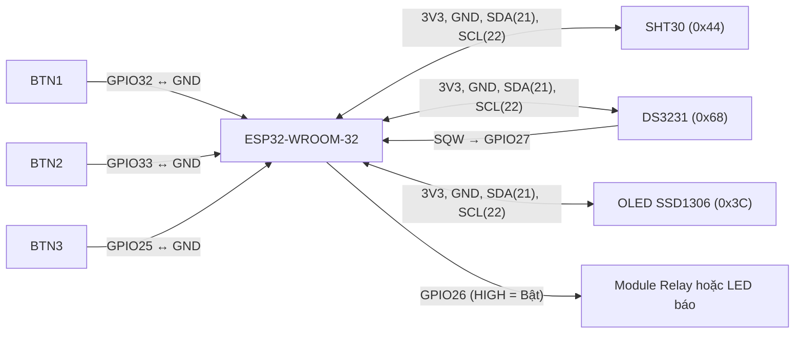

# Sơ đồ đấu nối

Áp dụng cho **ESP32-WROOM-32 / ESP32 DevKit / NodeMCU-32S**. Không dùng sơ đồ này cho các dòng ESP32-S2/S3/C3/C6.

---

## 1. Quy tắc an toàn

1. **Rút cáp USB** khỏi máy tính trước khi cắm hoặc tháo dây.
2. **Đọc đúng chữ in trên mạch (`GPIO` / `IO` / `3V3` / `GND`)**, tuyệt đối không đếm thứ tự chân vì mỗi hãng làm vỏ mạch có thể xếp chân khác nhau.
3. **Cấp nguồn 3V3 cho các cảm biến và màn hình**, nối chung tất cả chân `GND` lại với nhau. Không cấp 5V cho SHT30, DS3231, OLED hay nút nhấn.

---

## 2. Bảng nối dây chi tiết

### 2.1. Cảm biến, màn hình và thời gian thực

Các chân có cùng tên trên ESP32 (`3V3`, `GND`, `GPIO21`, `GPIO22`) sẽ được cắm chung trên cùng các hàng của breadboard.

| Thiết bị | Chân trên thiết bị | Nối vào chân ESP32 | Lưu ý cho người lắp |
|---|---|---|---|
| **Cảm biến nhiệt ẩm (SHT30)** | `VCC` (hoặc `VIN`) | **3V3** | Kiểm tra kỹ chữ in trên mạch, tránh cắm ngược cực |
| | `GND` | **GND** | Dùng chung với các thiết bị khác |
| | `SDA` | **GPIO21** | Nối chung hàng với SDA của DS3231 và OLED |
| | `SCL` | **GPIO22** | Nối chung hàng với SCL của DS3231 và OLED |
| **Đồng hồ thời gian thực (DS3231)** | `VCC` | **3V3** | Lắp pin cúc áo phù hợp để giữ giờ khi rút điện |
| | `GND` | **GND** | Dùng chung với các thiết bị khác |
| | `SDA` | **GPIO21** | Nối chung hàng với SHT30 và OLED |
| | `SCL` | **GPIO22** | Nối chung hàng với SHT30 và OLED |
| | `SQW` (hoặc `INT`) | **GPIO27** | **Cẩn thận:** Không cắm nhầm sang chân `32K` cạnh đó |
| **Màn hình OLED (SSD1306 128×64)** | `VCC` (hoặc `VDD`) | **3V3** | Chú ý thứ tự `VCC` và `GND` (tùy lô mạch có thể đảo vị trí) |
| | `GND` | **GND** | Dùng chung với các thiết bị khác |
| | `SDA` | **GPIO21** | Nối chung hàng với SHT30 và DS3231 |
| | `SCL` (hoặc `SCK`) | **GPIO22** | Trên một số màn OLED, chân `SCL` được in là `SCK` |

### 2.2. Nút nhấn điều khiển

Mỗi nút nhấn chỉ cần **2 sợi dây**: 1 chân nối vào `GPIO`, chân còn lại nối thẳng xuống `GND` (không cấp `3V3` vào nút).

| Nút nhấn | Chân 1 | Chân 2 | Chức năng |
|---|---|---|---|
| **BTN1** | **GPIO32** | **GND** | Đổi trang màn hình OLED |
| **BTN2** | **GPIO33** | **GND** | Tắt tiếng còi báo động tại chỗ (ACK / Mute) |
| **BTN3** | **GPIO25** | **GND** | Giả lập quá nhiệt (9,50°C trong 15 giây) để kiểm tra |
| **Nút BOOT** | **GPIO0** *(có sẵn trên ESP32)* | — | Nhấn giữ 5 giây khi mạch đang chạy để xóa Wi-Fi cũ |

> **Mẹo cắm nút nhấn 4 chân:** Nút bấm vuông 4 chân có 2 cặp chân đã thông sẵn bên trong. Để không phải đo, hãy cắm **2 chân chéo góc nhau** (1 góc vào `GPIO`, góc đối diện chéo qua tâm nút nối vào `GND`) là chắc chắn đúng.

### 2.3. Cảnh báo, đèn báo và đo pin

| Thành phần | Chân thiết bị | Nối vào chân ESP32 | Cách đấu nối chi tiết |
|---|---|---|---|
| **Cảnh báo (Đèn LED thử nghiệm)** | Chân dài LED (`+`) | **GPIO26** (qua trở `330 Ω`) | `GPIO26` → Điện trở `330 Ω` → Chân dài LED (`+`) \| Chân ngắn LED (`-`) → `GND` |
| **Cảnh báo (Module Relay / Còi)** | `IN` | **GPIO26** | Chọn module Relay kích mức cao (**HIGH**) hỗ trợ tín hiệu 3,3V. Nối chung `GND`. Không cắm trực tiếp còi công suất lớn vào chân ESP32 |
| **Đo điện áp Pin** | Điểm giữa 2 điện trở | **GPIO34** | Xem sơ đồ chia áp ở Mục 3.2 (chỉ bật trong code sau khi đã lắp đủ điện trở) |
| **LED trạng thái** | LED tích hợp trên mạch | **GPIO2** | Đã nối sẵn trên đa số board ESP32, không cần cắm thêm dây |

---

## 3. Sơ đồ trực quan

### 3.1. Sơ đồ nối dây chính

```text
ESP32                  SHT30             DS3231            OLED SSD1306
3V3 ------------------ VCC ------------- VCC ------------- VCC
GND ------------------ GND ------------- GND ------------- GND
GPIO21 --------------- SDA ------------- SDA ------------- SDA
GPIO22 --------------- SCL ------------- SCL ------------- SCL (hoặc SCK)
GPIO27 --------------------------------- SQW

GPIO32 ---- [ Nút BTN1 ] ---- GND
GPIO33 ---- [ Nút BTN2 ] ---- GND
GPIO25 ---- [ Nút BTN3 ] ---- GND

GPIO26 ---- [ Trở 330Ω ] ---- [ LED (+) | LED (-) ] ---- GND   (Hoặc nối vào chân IN của Module Relay)
```



> **Lưu ý kỹ thuật cho đường tín hiệu:**
> - **Dây I2C (`GPIO21`, `GPIO22`):** Cắm dây càng ngắn càng tốt. Hầu hết module SHT30/DS3231/OLED bán sẵn đã có điện trở kéo lên (pull-up). Nếu dùng mạch tự thiết kế chưa có trở, nối thêm trở `4,7 kΩ` từ `SDA` lên `3V3` và từ `SCL` lên `3V3`.
> - **Chân `SQW` (`GPIO27`):** Đã bật trở kéo nội trong chip. Nếu đi dây dài bị nhiễu, có thể mắc thêm trở `4,7–10 kΩ` từ `GPIO27` lên `3V3`.

### 3.2. Sơ đồ mạch đo pin (tùy chọn)

**Cảnh báo:** Tuyệt đối không nối thẳng cực dương của pin (3,7V – 4,2V) vào chân ESP32 vì sẽ làm hỏng chân đọc. Phải đi qua 2 điện trở `100 kΩ` chia đôi điện áp như hình dưới:

```text
Cực dương Pin (+) ---- [ Trở R1: 100 kΩ ] ----+---- [ Trở R2: 100 kΩ ] ---- GND
                                              |
                                              +---- [ Tụ 100 nF ] --------- GND
                                              |
                                           GPIO34 (ESP32)
```

*(Mặc định tính năng đo pin được tắt khi chỉ cắm cáp USB. Sau khi lắp mạch trên, đổi cờ `GSP_BATTERY_CONNECTED=1` trong `platformio.ini` để hiển thị dung lượng pin).*

---

## 4. Chân chờ cho Thẻ nhớ MicroSD

Hiện tại chưa cần cắm thẻ nhớ. Giữ trống các chân sau để lắp module MicroSD ở giai đoạn tiếp theo:

| Chân trên module MicroSD | Nối vào chân ESP32 |
|---|---|
| `CS` | **GPIO13** |
| `MOSI` | **GPIO23** |
| `SCK` | **GPIO18** |
| `MISO` | **GPIO19** |

---

## 5. Các chân trên ESP32 KHÔNG ĐƯỢC cắm thêm thiết bị

Khi cần gắn thêm linh kiện ngoài danh sách trên, **tránh tuyệt đối** các chân sau:
- **GPIO6 đến GPIO11:** Chân nối bộ nhớ Flash bên trong chip, cắm dây vào sẽ làm treo mạch.
- **GPIO1 và GPIO3 (`TX0` / `RX0`):** Chân nạp code và truyền dữ liệu qua cáp USB.
- **GPIO0, GPIO2, GPIO5, GPIO12, GPIO15:** Các chân khởi động (strapping pins) — nếu gắn thiết bị kéo lệch điện áp lúc mới cắm điện sẽ khiến ESP32 không khởi động hoặc không nạp được code.
- **GPIO34 đến GPIO39:** Chỉ nhận tín hiệu vào (Input-only), không phát được tín hiệu điều khiển và không có điện trở kéo nội (không dùng để nối trực tiếp nút nhấn).