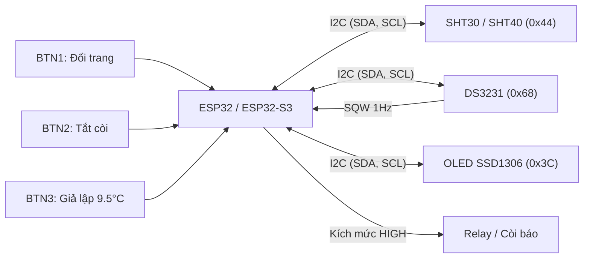

# Sơ đồ đấu nối phần cứng

Áp dụng cho ESP32 Classic và ESP32-S3. Hỗ trợ cảm biến SHT30/SHT40 và RTC DS3231.

---

## 1. Nguyên tắc an toàn

1. Ngắt nguồn USB trước khi cắm hoặc rút dây nối.
2. Kiểm tra đúng ký hiệu chân trên bo mạch: 3V3, GND, số hiệu GPIO.
3. Cấp nguồn 3.3V cho SHT30/SHT40, DS3231, OLED; nối chung toàn bộ mass GND.

---

## 2. Bảng gán chân

| Thiết bị / Chức năng | Chân module | ESP32 Classic | ESP32-S3 | Ghi chú |
| :--- | :--- | :--- | :--- | :--- |
| **Cảm biến SHT30 / SHT40** | VCC | 3V3 | 3V3 | Nguồn 3.3V |
| | GND | GND | GND | Nối chung GND |
| | SDA | **GPIO21** | **GPIO8** | Chung bus I2C với OLED và RTC |
| | SCL | **GPIO22** | **GPIO9** | Chung bus I2C với OLED và RTC |
| **RTC DS3231** | VCC | 3V3 | 3V3 | Lắp pin CR2032 dự phòng |
| | GND | GND | GND | Nối chung GND |
| | SDA | **GPIO21** | **GPIO8** | Chung bus I2C |
| | SCL | **GPIO22** | **GPIO9** | Chung bus I2C |
| | SQW | **GPIO27** | **GPIO6** | Ngắt xung nhịp 1Hz |
| **Màn hình OLED SSD1306** | VCC / VDD | 3V3 | 3V3 | Nguồn 3.3V |
| | GND | GND | GND | Nối chung GND |
| | SDA | **GPIO21** | **GPIO8** | Chung bus I2C |
| | SCL / SCK | **GPIO22** | **GPIO9** | Chung bus I2C |
| **Nút bấm BTN1** | Chân tín hiệu | **GPIO32** | **GPIO4** | Đổi trang OLED; chân kia nối GND |
| **Nút bấm BTN2** | Chân tín hiệu | **GPIO33** | **GPIO5** | Tắt còi báo; chân kia nối GND |
| **Nút bấm BTN3** | Chân tín hiệu | **GPIO25** | **GPIO15** | Giả lập quá nhiệt 9.5°C; chân kia nối GND |
| **Nút BOOT** | Tích hợp | **GPIO0** | **GPIO0** | Giữ 5 giây để reset cấu hình WiFi |
| **Relay / Còi báo** | IN / Anode | **GPIO26** | **GPIO7** | Mức HIGH kích hoạt còi/đèn |
| **Đo điện áp pin** | Cầu phân áp | **GPIO34** | **GPIO1** | Cầu phân áp 2 trở 100kΩ, tụ 100nF |
| **LED trạng thái** | Tích hợp | **GPIO2** | **GPIO2** | Báo trạng thái hoạt động |

> **Cấu hình phần mềm:** SHT30 và SHT40 dùng chung sơ đồ chân I2C. Chọn cảm biến qua `build_flags` trong `firmware/platformio.ini` (`-D SENSOR_TYPE_SHT40` hoặc `-D SENSOR_TYPE_SHT30`).

---

## 3. Sơ đồ khối ngoại vi



---

## 4. Mạch đo điện áp pin

Điện áp pin 3.7V đến 4.2V đi qua cầu phân áp chia đôi trước khi vào chân ADC:

```text
Cực dương Pin (+) ---- [ Trở R1: 100 kΩ ] ----+---- [ Trở R2: 100 kΩ ] ---- GND
                                              |
                                              +---- [ Tụ 100 nF ] --------- GND
                                              |
                                     GPIO34 (Classic) / GPIO1 (S3)
```

Bật cờ `GSP_BATTERY_CONNECTED=1` trong `firmware/platformio.ini` khi kết nối mạch đo pin.
