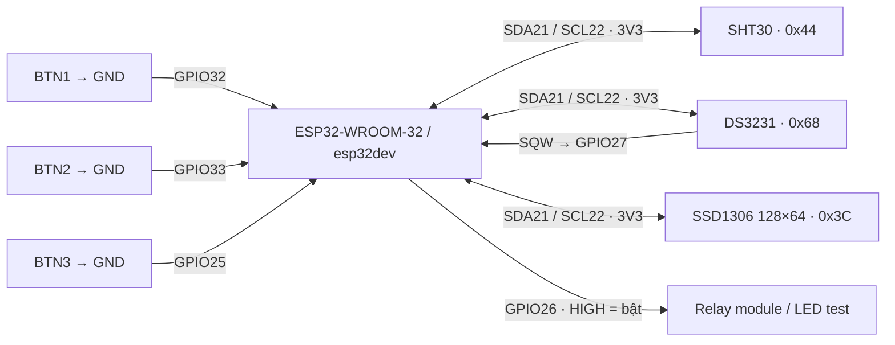

# Sơ đồ đấu nối — ESP32 thường / ESP32-WROOM-32

Cập nhật 2026-11-12 theo board thực tế của người dùng. Firmware dùng PlatformIO `esp32dev`, flash 4 MB, không cần PSRAM. Hướng dẫn nạp và test đầy đủ tại [Sprint 1](../02_testing_and_handover/sprint1/esp32_guide.md).

## 1. Gán chân đang dùng

| Chức năng | Chân module | GPIO ESP32 thường | Cấu hình |
|---|---|---|---|
| I2C dùng chung: SHT30 `0x44`, DS3231 `0x68`, OLED SSD1306 `0x3C` | SDA | **21** | I2C 400 kHz, pull-up lên 3V3 |
| I2C dùng chung | SCL | **22** | Các module mắc song song |
| RTC 1 Hz | SQW/INT | **27** | INPUT_PULLUP, ngắt FALLING; không dùng chân 32K |
| BTN1 | Nút → GND | **32** | INPUT_PULLUP, ngắt CHANGE, đổi trang OLED |
| BTN2 | Nút → GND | **33** | INPUT_PULLUP, ngắt CHANGE, ACK/Mute |
| BTN3 | Nút → GND | **25** | INPUT_PULLUP, ngắt CHANGE, test 9,50°C trong 15 s |
| Relay/cảnh báo | IN | **26** | OUTPUT, active HIGH; module phải nhận được logic 3,3 V |
| Đo pin qua phân áp | Điểm giữa hai trở | **34 (ADC1_CH6)** | Tùy chọn, bật `GSP_BATTERY_CONNECTED=1` sau khi lắp mạch |
| LED trạng thái | LED trên board nếu có | **2** | Không bắt buộc phải có LED để test cảm biến |
| Reset Wi-Fi | BOOT có sẵn | **0** | Giữ 5 giây khi firmware đang chạy |

Cấp SHT30, DS3231, OLED bằng **3V3** và chung **GND**. Kiểm tra thứ tự chân trên từng breakout. Không cấp 5 V cho module rồi để điện trở pull-up kéo SDA/SCL/SQW lên 5 V.



## 2. Bus I2C và nút nhấn

```text
ESP32         SHT30          DS3231         OLED
3V3 ---------- VCC ---------- VCC ---------- VCC
GND ---------- GND ---------- GND ---------- GND
GPIO21 ------- SDA ---------- SDA ---------- SDA
GPIO22 ------- SCL ---------- SCL ---------- SCL
GPIO27 --------------------- SQW

GPIO32 ---- [BTN1] ---- GND
GPIO33 ---- [BTN2] ---- GND
GPIO25 ---- [BTN3] ---- GND
```

Dây I2C nên ngắn. Nhiều breakout có sẵn pull-up; kiểm tra trước khi thêm trở. Nếu chưa có, dùng khoảng 4,7 kΩ từ SDA/SCL lên 3V3. SQW dùng pull-up nội, có thể thêm 4,7–10 kΩ lên 3V3 khi cần. Ba nút dùng pull-up nội và không cần VCC. Với nút tact 4 chân, chọn hai chân không nối sẵn bên trong.

## 3. Pin và cảnh báo tùy chọn

Đo pin: `pin+ → R1 100 kΩ → GPIO34 → R2 100 kΩ → GND`, thêm tụ 100 nF giữa GPIO34 và GND. Firmware tính `analogReadMilliVolts(34) / 1000 × 2`. Mặc định tắt đo pin để không đọc ADC trôi khi chỉ cấp USB; OLED hiện N/A, payload `bat_v=0.00`. Bật cờ `GSP_BATTERY_CONNECTED=1` sau khi lắp phân áp và đối chiếu đồng hồ. Không đưa pin 4,2 V trực tiếp vào GPIO.

Test alarm đơn giản: `GPIO26 → trở 330 Ω → LED → GND`. Relay thật phải có driver/transistor/diode trên module, nhận được tín hiệu 3,3 V và chọn kích HIGH. VCC relay cấp theo thông số module, GND chung. Với tải DC thấp áp: nguồn tải+ → COM, NO → tải+, tải− → nguồn tải−. Không lấy dòng cuộn relay/còi từ GPIO hoặc chân 3V3 của cảm biến.

## 4. Phần dành cho Sprint 2

MicroSD chưa triển khai trong Sprint 1. Bảng chân dự kiến để tránh xung đột trên ESP32 thường:

| Tín hiệu MicroSD | GPIO dự kiến |
|---|---|
| CS | 13 |
| MOSI | 23 |
| SCK | 18 |
| MISO | 19 |

Khi triển khai phải khởi tạo SPI theo đúng bảng này và chọn module có nguồn/mức logic phù hợp. Không dùng GPIO10–13 của sơ đồ S3 cũ: trên ESP32 thường, GPIO6–11 nối flash.

## 5. Chân cần tránh khi mở rộng

- **GPIO6–11:** bus flash của ESP32-WROOM-32, không đấu cảm biến/nút vào đây.
- **GPIO34–39:** chỉ vào, không có pull-up/pull-down nội; GPIO34 phù hợp ADC với mạch phân áp ngoài.
- **GPIO1/3:** UART0 phục vụ USB-UART/Serial, để trống khi test/nạp.
- **GPIO0/2/5/12/15:** chân strapping; tránh thêm tải/pull làm thay đổi mức khi reset. Chỉ dùng GPIO0/2 theo chức năng sẵn có trong bảng trên.
- Dùng **ADC1** cho đo pin khi Wi-Fi hoạt động; không chuyển sang ADC2.

Thông tin chân đối chiếu [ESP32-WROOM-32 datasheet của Espressif](https://www.espressif.com/sites/default/files/documentation/esp32-wroom-32_datasheet_en.pdf); cấu hình bus theo [Arduino-ESP32 I2C API](https://docs.espressif.com/projects/arduino-esp32/en/latest/api/i2c.html).
